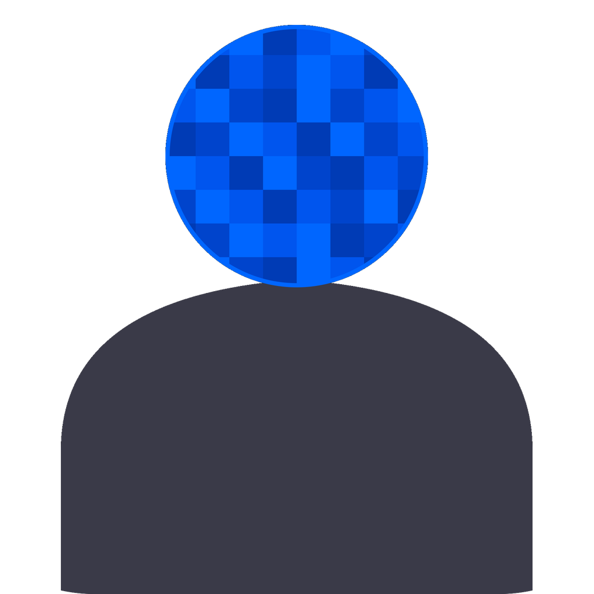

  
  <h1>GhostFrame Studio</h1>
  
Hide faces in video, one person at a time.

[Español](README.md) · **English**

**[Download for Windows](https://github.com/adamrz5/GhostFrame-Studio/releases/latest)** · [Watch the demo](#demo) · [Install from source](docs/instalacion.md)

GhostFrame Studio analyzes videos on your computer and groups each person's appearances, even when they leave the shot and come back. It's built for interviews, documentaries, and other footage where you need to hide some faces and keep others visible.

## Demo

https://github.com/user-attachments/assets/fe1f2fd0-ec49-4e6f-a274-bda56f3768ec

## Features

| Feature | What it does |
| --- | --- |
| **Per-person redaction** | Choose pixelation, Gaussian blur, or a black box. Set the strength, padding, and time range for each effect. |
| **Face tracking** | See where each person appears on the timeline and merge profiles if the analysis splits one person into multiple profiles. |
| **Preview and export** | Check the effects before rendering the result to MP4 with FFmpeg. |
| **Saved sessions and batch processing** | Reuse a saved analysis or process a folder of videos. |

## Installation

1. Download `GhostFrame-Setup-*.exe` from the [latest release](https://github.com/adamrz5/GhostFrame-Studio/releases/latest) and run it.
2. Open GhostFrame Studio. The first launch requires an internet connection to download the face detection model.

The installer is available for **64-bit Windows 10 and 11**. Analysis can use **CUDA** on NVIDIA GPUs, **DirectML** on compatible DirectX 12 GPUs, or the **CPU**. To run from source with Python 3.12 and set up FFmpeg, see the [installation guide in Spanish](docs/instalacion.md).

## Your first video

The app uses Spanish labels. Here's how to find the controls.

1. Drag an MP4, MOV, MKV, or AVI file into the window and click **Analizar** (Analyze).
2. Enable redaction on the cards for the people you want to hide and choose an effect.
3. Scrub through the timeline to check that the effect covers each selected face when it appears.
4. Click **Renderizar** (Render) and choose where to save the MP4.

## Documentation and contributions

- [User guide (Spanish)](docs/uso.md) for keyboard shortcuts, advanced settings, and troubleshooting.
- [Architecture (Spanish)](docs/arquitectura.md) for how InsightFace, ArcFace, and FFmpeg work together.
- [Changelog (Spanish)](CHANGELOG.md) for release history.

If you find a bug, include your GhostFrame Studio version, steps to reproduce it, and the error message when you [open an issue](https://github.com/adamrz5/GhostFrame-Studio/issues/new). To propose a code change, you can [open a pull request](https://github.com/adamrz5/GhostFrame-Studio/pulls).

Released under the [MIT license](LICENSE).
