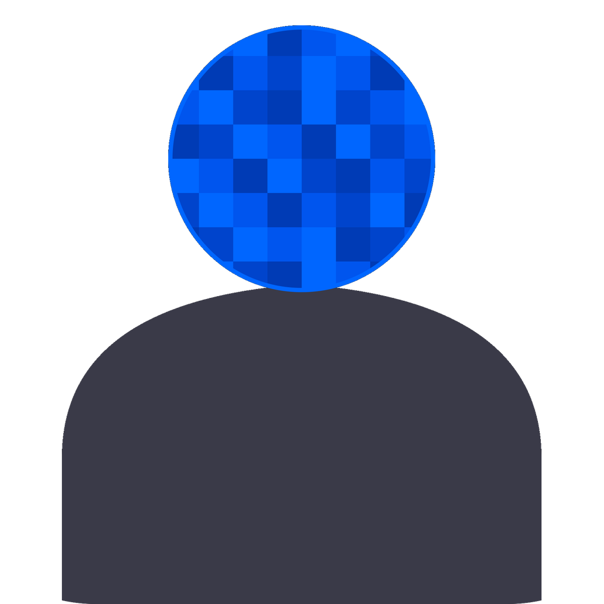

  
  <h1>GhostFrame Studio</h1>
  
Oculta rostros en vídeo, persona por persona.

**Español** · [English](README.en.md)

**[Descargar para Windows](https://github.com/adamrz5/GhostFrame-Studio/releases/latest)** · [Ver demo](#demo) · [Instalar desde el código](docs/instalacion.md)

GhostFrame Studio analiza vídeos en tu equipo y agrupa las apariciones de una misma persona, incluso si sale del plano y vuelve. Está pensado para entrevistas, reportajes y otros vídeos en los que necesitas ocultar unas caras y dejar otras visibles.

## Demo

https://github.com/user-attachments/assets/fe1f2fd0-ec49-4e6f-a274-bda56f3768ec

## Qué puedes hacer

| Función | Cómo se usa |
| --- | --- |
| **Censura por persona** | Elige pixelado, desenfoque gaussiano o caja negra. Ajusta la intensidad, el margen y el tramo de aplicación de cada efecto. |
| **Seguimiento facial** | Consulta las apariciones de cada persona en la línea de tiempo y fusiona perfiles si el análisis separa a una misma persona. |
| **Vista previa y exportación** | Revisa los efectos antes de renderizar el resultado a MP4 con FFmpeg. |
| **Sesiones y lotes** | Reutiliza un análisis guardado o procesa una carpeta de vídeos. |

## Instalación

1. Descarga `GhostFrame-Setup-*.exe` desde la [última versión](https://github.com/adamrz5/GhostFrame-Studio/releases/latest) y ejecútalo.
2. Abre GhostFrame Studio. En el primer arranque se descarga el modelo de detección facial, por lo que necesitas conexión a internet.

El instalador está disponible para **Windows 10 y 11 de 64 bits**. El análisis puede usar **CUDA** en NVIDIA, **DirectML** en GPU compatibles con DirectX 12 o **CPU**. Para ejecutar el código fuente con Python 3.12 y configurar FFmpeg, sigue la [guía de instalación](docs/instalacion.md).

## Primer vídeo

1. Arrastra un vídeo MP4, MOV, MKV o AVI a la ventana y pulsa **Analizar**.
2. Activa la censura en las tarjetas de las personas que quieras ocultar y elige el efecto.
3. Recorre la línea de tiempo y comprueba que la censura cubre a cada persona cuando aparece.
4. Pulsa **Renderizar** y elige dónde guardar el MP4.

## Documentación y contribuciones

- [Guía de uso](docs/uso.md) para atajos, ajustes avanzados y solución de problemas.
- [Arquitectura](docs/arquitectura.md) para entender cómo se combinan InsightFace, ArcFace y FFmpeg.
- [Historial de cambios](CHANGELOG.md) para consultar las novedades de cada versión.

Si encuentras un fallo, incluye la versión de GhostFrame Studio, los pasos para reproducirlo y el mensaje de error al [abrir un issue](https://github.com/adamrz5/GhostFrame-Studio/issues/new). Si propones un cambio de código, puedes [abrir un pull request](https://github.com/adamrz5/GhostFrame-Studio/pulls).

Distribuido bajo la [licencia MIT](LICENSE).
